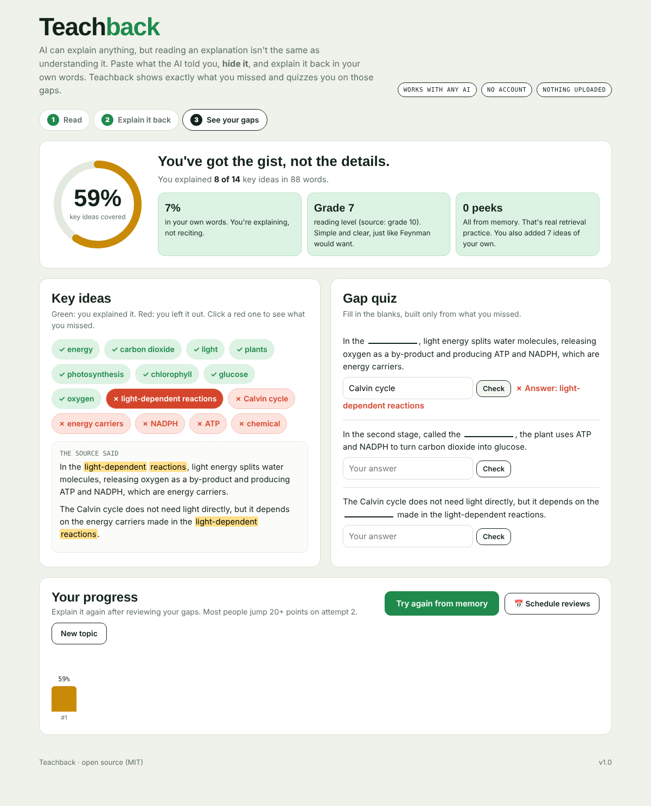

# Teachback 🧠

**Close the AI tab and explain it back.** Paste an explanation from ChatGPT, Claude, Gemini or your notes. Teachback hides it, you explain it back from memory, and it shows exactly which key ideas you missed, then quizzes you on those gaps.

**▶ Live demo:** `https://hpinyan5-wq.github.io/teachback/?demo`



## Why this exists

AI made explanations instant, and that created a new problem: **the illusion of understanding.** You read a clear AI answer, it feels obvious, you move on, and two days later it's gone.

Learning science has a well-tested fix: **retrieval practice.** Explaining something from memory (the Feynman technique) beats re-reading. But nobody tells you *what* you left out.

Teachback turns any AI answer into a 2-minute understanding check.

## Features

- **Hide and explain**: the source is blurred while you write. Peeking is allowed but counted.
- **Key-idea extraction**: automatically finds the 6–16 core concepts in the source (technical terms, repeated multi-word phrases and acronyms are weighted higher)
- **Coverage score**: which ideas you explained (green) and which you left out (red)
- **Click a gap** to see it highlighted in the original explanation
- **Parrot detector**: catches memorized, word-for-word recitation ("you're reciting, not explaining")
- **Feynman simplicity check**: compares the reading grade level of your explanation with the source's
- **Gap quiz**: fill-in-the-blank questions built *only* from what you missed, auto-graded
- **Progress across attempts**: explain again and watch your score climb
- **Spaced repetition**: one click adds reviews on day 1, 3, 7 and 21 to your calendar (.ics)

## How it works

No AI is used to grade you. That makes it instant, free, private, and impossible to "prompt" your way around.

1. Sentences are tokenized and stemmed, and candidate concepts are collected as 1–3 word runs between stop-words.
2. Candidates are scored by frequency, phrase length, capitalization, acronyms and technicality, and overlapping candidates are merged.
3. A concept counts as covered if its key stems appear in your explanation.
4. The parroting score uses 5-word overlap with the source, and readability uses the Flesch–Kincaid grade.

It's one HTML file with no dependencies.

## Run it

```bash
git clone https://github.com/hpinyan5-wq/teachback.git
open teachback/index.html
```

Or deploy: **Settings → Pages → Deploy from branch → main / root**.

## Roadmap

- [ ] Voice mode: explain it out loud (Web Speech API)
- [ ] Chinese (中文) concept extraction
- [ ] Synonym matching ("CO₂" = "carbon dioxide")
- [ ] Class mode: a teacher shares a source link and students explain it back

## License

MIT
